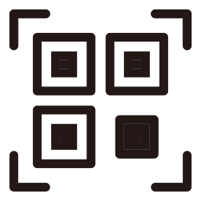

※このREADMEは、プログラムを基にAIが生成しました

# ScreenQRReader

ScreenQRReaderは、デスクトップ画面に表示されているQRコードを素早く読み取るためのツールです。ホットキーを押して範囲を選択するだけで、QRコードの内容を自動的に処理します。



## 主な機能

*   **ホットキー起動:** `Ctrl+Shift+Q` を押すだけで、いつでもキャプチャを開始できます。
*   **直感的な範囲選択:** マウスをドラッグして、QRコードが含まれる領域を簡単に選択できます。
*   **自動アクション:**
    *   読み取った内容がURLの場合、自動的にデフォルトのブラウザで開きます。
    *   テキストデータの場合、クリップボードにコピーします。
*   **タスクトレイ常駐:** アプリはバックグラウンドで静かに動作し、必要な時だけ呼び出せます。

## 使い方

1.  アプリケーションを起動します。
2.  タスクトレイにアイコンが表示され、アプリがバックグラウンドで待機します。
3.  画面上のQRコードを読み取りたい場面で `Ctrl+Shift+Q` を押します。
4.  画面全体が少し暗くなり、カーソルが十字に変わります。
5.  QRコードを含む領域をマウスでドラッグして選択します。
6.  マウスボタンを離すと、QRコードが自動的に処理されます。

## 開発者向け

このプロジェクトは Rust と egui (eframe) を使用して構築されています。

### ビルドと実行

プロジェクトのルートディレクトリで以下のコマンドを実行します。

```bash
cargo run
```
